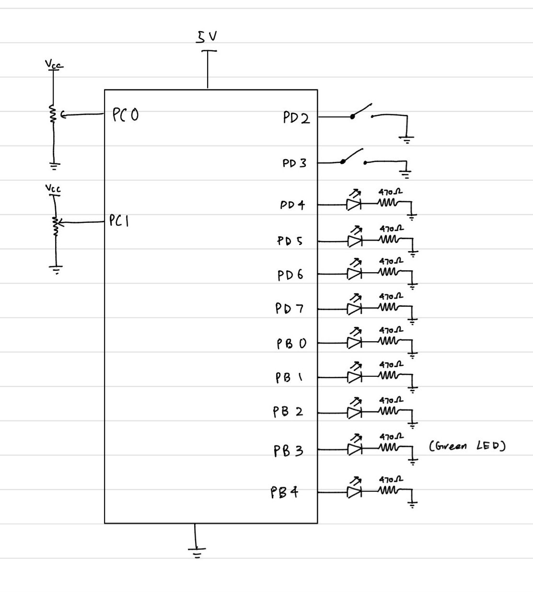

# LED Sequencer

An eight-LED sequencer for the ATmega328P on an Arduino Uno. It runs four light patterns and a two-player tug-of-war game, with knobs for speed and brightness. The ADC, Timer2 and the external interrupts are set up through the chip's registers directly. Built as a school project.

https://github.com/user-attachments/assets/bc59856c-d406-49bc-87d8-b95b9e236c13



## Patterns

Button 1 steps through the patterns in order.

| # | Pattern | What it does |
|---|---|---|
| 0 | Rotate | One LED steps from LED 0 to LED 7, then wraps around. |
| 1 | Rotate back | The same, from LED 7 to LED 0. |
| 2 | Bounce fill | A block of LEDs slides to one end, grows by one LED and slides back. When it reaches eight LEDs, all of them flash five times and it starts again with one. |
| 3 | Alternate | Even and odd LEDs take turns, at half the speed of the other patterns. |
| 4 | Tug of war | A two-player game for the two buttons (see below). |

In software PWM mode, patterns 0 and 1 draw a comet: the moving LED at full brightness, with a two-LED tail behind it at a third and a fifth of that brightness.

## Controls

| Input | Pin | Does |
|---|---|---|
| Speed knob | PC0 (ADC0) | Sets the time per step, from 100 ms to 610 ms. Turning it up makes the patterns faster. |
| Brightness knob | PC1 (ADC1) | Sets the brightness, 0 to 255. |
| Button 1 | PD2 (INT0) | Next pattern. Clears the LEDs and restarts the pattern from the beginning. |
| Button 2 | PD3 (INT1) | Switches between software PWM and hardware PWM. |

Both buttons trigger on the falling edge and use the internal pull-ups. Each interrupt ignores presses within 200 ms of the last one, using `millis()`.

## How it works

**Software PWM (the default).** Timer2 runs in CTC mode and fires an interrupt about 7,700 times a second. The interrupt counts from 0 to 31 and switches each LED on while the count is below that LED's brightness. That gives 32 brightness levels per LED at about 240 Hz, which is how the comet tail gets its dimmer LEDs.

**Hardware PWM.** Timer2 switches to fast PWM and drives its OC2A pin (PB3, the green LED) directly, with the brightness knob setting the duty cycle. The timer interrupt is turned off, so the pattern LEDs run at full brightness and patterns 0 and 1 show a single LED with no tail. The pattern LEDs skip PB3 so this pin stays free.

**Knobs.** The ADC uses AVcc as its reference and a /128 clock. Each step of a pattern reads both knobs by polling.

**Tug of war.** The button interrupts are turned off and both buttons are polled every 20 ms instead. A lit LED starts at LED 3. Each new press of button 1 moves it one step toward LED 0, and each new press of button 2 moves it toward LED 7. Holding a button down does nothing. When it reaches either end, the three LEDs on that side flash five times, and the board goes back to pattern 0 in software PWM mode.

## Constraints

The brief banned Arduino's I/O and interrupt functions apart from `delay()` and `millis()`, so the pins, ADC, timer and interrupts are all driven through registers. Brightness control of one LED with hardware PWM and of several LEDs with timers were graded separately, which is why both PWM modes exist and a button switches between them.

## Hardware

- Arduino Uno (ATmega328P, 16 MHz)
- 8 LEDs for the patterns: LED 0 to 3 on PD4 to PD7, LED 4 to 6 on PB0 to PB2, LED 7 on PB4
- 1 green LED on PB3 for hardware PWM
- A 470 Ω resistor in series with each LED
- 2 potentiometers between 5 V and ground, wipers to PC0 and PC1
- 2 push buttons from PD2 and PD3 to ground

## Running it

Open `led_sequencer/led_sequencer.ino` in the Arduino IDE, choose Arduino Uno as the board, and upload.

With arduino-cli:

```
arduino-cli core install arduino:avr
arduino-cli compile --fqbn arduino:avr:uno led_sequencer
arduino-cli upload -p <port> --fqbn arduino:avr:uno led_sequencer
```
